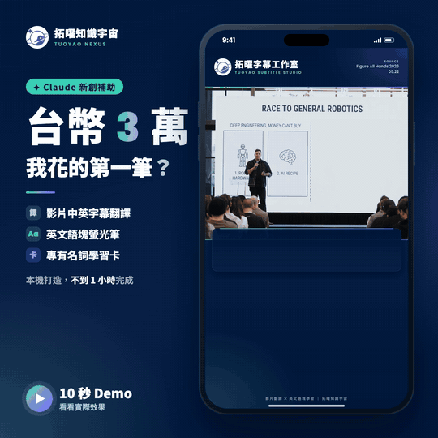
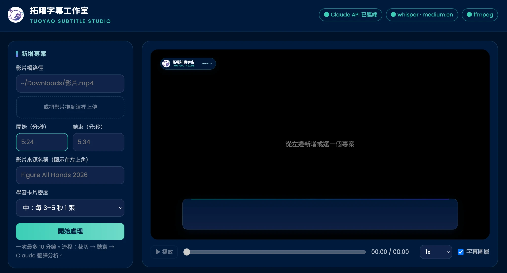
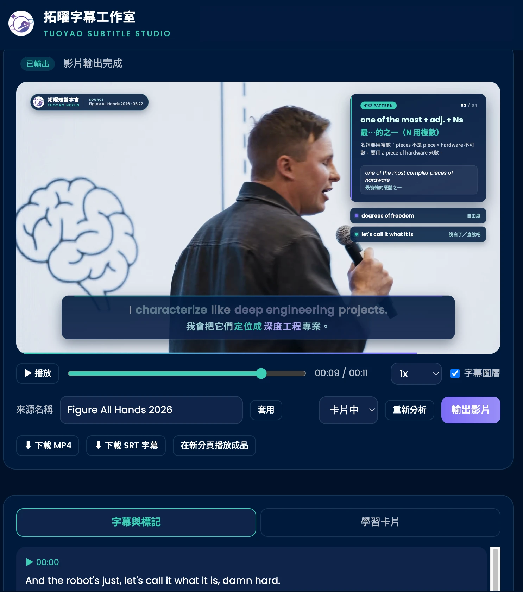

# 拓曜字幕工作室 Subtitle Studio

把英文影片片段做成「中英雙語字幕＋英文語塊學習卡片」的教學影片，配色沿用拓曜知識宇宙官網品牌色。

## 示範

[](docs/demo.mp4)

點上方動畫可以看完整、有聲音的示範影片。

| 首頁 | 預覽與編輯 |
|---|---|
|  |  |

> 示範影片素材出處：Figure AI《[Figure All Hands 2026](https://www.youtube.com/watch?v=AoFwpf43wK0&t=322s)》05:22–05:34，約 12 秒片段。僅用於展示本工具的字幕與學習卡片功能，影片內容版權屬 Figure AI 所有。

## 第一次使用

1. 安裝套件：

   ```bash
   cd ~/Sites/subtitle-studio && npm install
   ```

2. 設定 AI 金鑰：把 `.env.example` 複製成 `.env`，在 `ANTHROPIC_API_KEY=` 後面貼上你自己的 Claude API 金鑰。想改用其他 AI，請看下方「改用其他 AI」。`.env` 已列在 `.gitignore`，不會被提交。

3. 啟動工具，然後打開 http://127.0.0.1:5177

   ```bash
   npm start
   ```

需要的本機工具：`ffmpeg`、`whisper`（openai-whisper）、Node.js 20.12 以上。第一次聽寫時，whisper 會先下載模型（medium.en 約 1.4 GB）。

## 改用其他 AI

翻譯分析預設使用 Claude（`claude-opus-5-5`），品質最穩，建議優先使用。也可以在 `.env` 改用其他 AI，`.env.example` 裡有各家的設定範例：

| `LLM_PROVIDER` | 服務 | 需要填 |
|---|---|---|
| `anthropic`（預設） | Claude | `ANTHROPIC_API_KEY` |
| `openai` | OpenAI | `LLM_API_KEY`、`LLM_MODEL` |
| `gemini` | Google Gemini | `LLM_API_KEY`、`LLM_MODEL` |
| `ollama` | Ollama（本機開源模型，免費） | `LLM_MODEL` |
| `custom` | 其他 OpenAI 相容服務（OpenRouter、DeepSeek、Groq 等） | `LLM_BASE_URL`、`LLM_API_KEY`、`LLM_MODEL` |

改完 `.env` 要重新啟動工具。網頁右上角的狀態燈會顯示目前使用的 AI 和模型。

注意事項：

- **品質看模型**：分句、台灣用語翻譯、語塊挑選都很吃模型能力。小型開源模型可能翻得生硬、卡片挑不準，也可能回傳格式錯誤（工具會自動重試一次）。
- **實測狀況**：Claude 已實測，品質穩定。Ollama 已實測能完整跑完流程，但用兩年前的 8B 小模型（llama3-taide）時，分句和翻譯品質明顯較差，建議用較新、較大的模型。OpenAI、Gemini 和其他服務走同一套接口，但作者尚未用真實金鑰實測。
- 費用記在你自己的 AI 帳號。

## 使用流程

1. **新增專案**：填影片檔路徑，或把影片拖進上傳區；再填開始、結束時間（格式為 `分:秒`，可以有小數，例如 `5:22.4`）和影片來源名稱。
2. **自動處理**：裁切 → whisper 聽寫英文 → AI 分句、翻譯、挑語塊與專有名詞、寫學習卡片。
3. **預覽與修改**：
   - 字幕與標記：修改中文翻譯、新增或刪除螢光筆標記（語塊用綠色、專有名詞用紫色）
   - 學習卡片：修改標題、中文意思、用法說明、例句
   - 改完按「儲存並更新預覽」
4. **輸出**：按「輸出影片」產生 1080p MP4，也可以下載 SRT 雙語字幕檔。

## 小提醒

- 一次最多處理 10 分鐘。片段越長，輸出越久：每秒影片約要渲染 24 格字幕圖層。
- 「重新分析」會覆蓋你手動改過的翻譯和卡片。
- 卡片的「對應的字幕標記」必須和某句字幕裡的標記英文相同，卡片才會出現在影片上。
- 目前只支援英文原音的影片。

## 授權與出處

### 程式碼：MIT 授權

本專案程式碼以 [MIT 授權](LICENSE) 釋出。你可以免費使用、修改、散布，也可以商用，唯一的條件是**在你的副本或修改版本中保留原本的版權聲明與授權文字**（Copyright (c) 2026 拓曜知識宇宙 Tuoyao Nexus）。

如果這個工具幫到你，歡迎在作品或說明裡註明「工具出自拓曜知識宇宙」，並附上[拓曜知識宇宙官網](https://tuoyaoco.com)或本 repo 連結。這是請求，不是授權條件。

### 品牌素材不在授權範圍內

MIT 授權只涵蓋程式碼。以下屬於拓曜知識宇宙的品牌識別，**不包含在授權內**：

- 拓曜 logo（`public/logo.png`、`demo/logo.png`）
- 「拓曜知識宇宙」「Tuoyao Nexus」「拓曜字幕工作室」等名稱

如果你要拿去做自己的版本或公開發布，請換成你自己的 logo 和名稱：替換 `public/logo.png`，並修改 `public/overlay.html` 和 `public/index.html` 裡的品牌文字。

### 示範內容

- `docs/` 裡的示範影片與 `demo/data.js` 的英文原文，取自 Figure AI《[Figure All Hands 2026](https://www.youtube.com/watch?v=AoFwpf43wK0&t=322s)》05:22–05:34 的短片段，只用來展示工具功能，影片內容版權屬 Figure AI 所有。
- 中文翻譯、語塊標記與學習卡片內容由本專案製作。

### 使用者責任

用這個工具處理的影片，請確認你有權使用。工具只負責產生字幕與學習卡片，不會替你取得任何影片的授權。

### 使用的第三方工具

| 工具 | 授權 |
|---|---|
| [openai-whisper](https://github.com/openai/whisper)（語音聽寫） | MIT |
| [@anthropic-ai/sdk](https://github.com/anthropics/anthropic-sdk-typescript)（Claude API） | Apache-2.0 |
| [openai](https://github.com/openai/openai-node)（OpenAI 相容接口） | Apache-2.0 |
| [Puppeteer](https://pptr.dev/)（渲染字幕圖層） | Apache-2.0 |
| [Express](https://expressjs.com/)、[Multer](https://github.com/expressjs/multer)、[Zod](https://zod.dev/) | MIT |
| [FFmpeg](https://ffmpeg.org/)（需自行安裝） | LGPL／GPL |
| Poppins、Noto Sans TC 字型（由 Google Fonts 載入） | SIL Open Font License 1.1 |

## 專案結構

```
server.mjs          本機伺服器（只開在 127.0.0.1）
lib/media.mjs       ffmpeg 裁切、whisper 聽寫
lib/analyze.mjs     AI 分析（預設 Claude；OpenAI 相容接口）、時間軸對齊、SRT
lib/render.mjs      逐格渲染字幕圖層，再用 ffmpeg 合成
public/index.html   操作介面
public/overlay.html 字幕與學習卡片版面（品牌色）
projects/<id>/      每個專案的片段、聽寫結果、分析結果、輸出檔
demo/               第一版設計 demo
```
